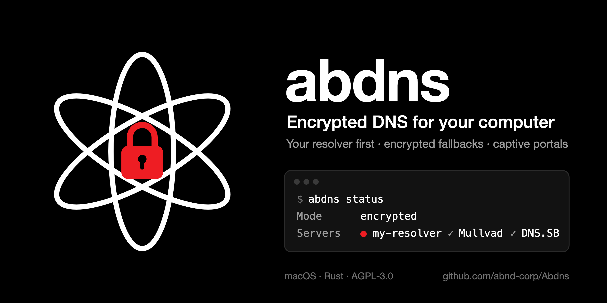

# abdns — DNS chiffré pour votre ordinateur, compatible avec les portails captifs

<p align="center"></p>

[](https://github.com/abnd-corp/Abdns/actions/workflows/ci.yml)

[English](README.md) · **Français**

**abdns est un client DNS-over-HTTPS (DoH) local pour macOS et Linux. Il envoie chaque requête DNS d'abord à votre propre résolveur, puis à des secours chiffrés dans l'ordre que vous choisissez, et n'utilise le DNS du réseau qu'en dernier recours, par exemple pour se connecter au portail captif du Wi-Fi d'un train, d'un hôtel ou d'un aéroport. Chaque domaine envoyé en clair vous est signalé.**

Il est écrit en Rust : un petit service (`abdnsd`) et un outil en ligne de commande (`abdns`), avec son propre client DoH (rustls, HTTP/2, magasin de certificats du système). Windows est prévu.

## Pourquoi

- **Votre résolveur, pas celui d'un autre.** Le poste interroge votre résolveur DoH auto-hébergé (Unbound, Knot Resolver, AdGuard Home, Pi-hole derrière un frontal DoH…), même joignable par sa seule adresse IP.
- **Pas de censure des résolveurs publics.** Dans plusieurs pays, les grands résolveurs publics appliquent des blocages ordonnés par la justice ou se retirent : en France, Google, Cloudflare, Cisco OpenDNS et DNS4EU ont reçu des ordres de blocage, et Quad9 cesse de servir les utilisateurs français le 24 novembre 2026.
- **Des secours chiffrés, dans votre ordre.** Si votre résolveur tombe, le serveur suivant de votre liste répond, puis le suivant. Les serveurs sont joints par adresse IP : aucune requête en clair pour les trouver.
- **Les portails captifs fonctionnent.** Les réglages de DNS chiffré natifs cassent la plupart des portails. abdns détecte la situation, utilise le DNS du réseau juste le temps nécessaire, ouvre la page de connexion, puis revient au chiffré dès qu'il répond.
- **Rien en clair à votre insu.** Tant que le DNS du réseau est utilisé, les nouveaux domaines sont signalés par notification et tous sont écrits dans un journal.

## Fonctionnement

```
applications ──► abdns (127.0.0.1:53) ──DoH──► serveur 1 (votre résolveur)
                    │                    └─DoH──► serveur 2, serveur 3… dans l'ordre, seulement si le précédent échoue
                    ├── noms locaux (.local, .lan, inverse de 192.168.x.x…) ──► DNS du réseau, sans notification
                    └── dernier recours : DNS du réseau (DHCP), en clair, signalé
```

| Situation | Réaction d'abdns |
|---|---|
| Le serveur 1 répond | Toutes les requêtes y vont en DoH ; les réponses sont gardées en cache le temps de leur durée de vie |
| Le serveur 1 échoue | Le serveur suivant répond aussitôt ; le serveur 1 est mis de côté (30 s, jusqu'à 5 min) et contrôlé toutes les 30 s |
| Un secours est utilisé depuis 1 min | Une notification (« Secours utilisé »), une autre au retour du serveur 1 |
| Aucun serveur ne répond mais une réponse est en cache | La dernière réponse connue est servie (jusqu'à un jour, RFC 8767) |
| Tous les serveurs échouent deux fois de suite **et** le DNS du réseau répond (portail captif, DoH bloqué) | Bascule sur le DNS du réseau, une seule notification, ouverture de la page de connexion si un portail est détecté |
| Nouveau réseau avec portail captif | Le portail est cherché pendant le premier contrôle : un seul échec de tous les serveurs suffit, la page de connexion s'ouvre aussitôt |
| Pas de réseau, ou un autre réseau | Aucun contrôle sans réseau ; un autre réseau reçoit des connexions neuves (le cache reste), une courte coupure du même réseau les garde ; la sortie de veille aussi reçoit des connexions neuves |
| Le DNS chiffré répond de nouveau | Retour au chiffré, avec la durée passée en clair et le nombre de domaines envoyés |
| Nom du réseau local (`nas.lan`, `imprimante.local`, `box.home.arpa`, domaine DHCP, recherche inverse d'une adresse privée comme 192.168.x.x) | Toujours envoyé au DNS du réseau, jamais signalé ni compté |
| Échec DNSSEC (SERVFAIL de votre résolveur) | Reste une erreur : jamais une raison de passer en clair |
| Le fichier de configuration change | Relu en moins de 5 s ; un fichier invalide est ignoré et signalé, l'ancien reste en service |
| abdns s'arrête ou plante | Le DNS du poste est remis sur celui du réseau : la machine n'est jamais sans DNS |

### Les portails captifs, pas à pas

1. Vous rejoignez le Wi-Fi d'un train ou d'un hôtel. Avant la connexion, le réseau bloque tous les serveurs de votre liste.
2. Après deux contrôles ratés (environ 15 s), abdns passe sur le DNS du réseau et vous prévient une fois.
3. Il charge la page d'essai d'Apple par le réseau : si la réponse n'est pas celle attendue, il y a un portail, et abdns ouvre sa page de connexion dans le navigateur.
4. Une fois connecté, vos serveurs chiffrés répondent de nouveau : abdns revient au chiffré en moins de 10 s et vous prévient.

`local_fallback = false` interdit ce dernier recours : les portails ne s'ouvriront plus, mais rien ne partira jamais en clair.

### Des notifications limitées

| Événement | Notifications |
|---|---|
| Passage sur le DNS du réseau | 1 |
| Domaines envoyés en clair | les nouveaux seulement, groupés, au plus toutes les 5 min |
| Toujours en clair | 1 toutes les 30 min |
| Retour au chiffré | 1 |
| Portail captif | 1 par réseau |
| Secours utilisé / serveur principal rétabli | 1 chacun |
| Configuration rechargée ou ignorée | 1 |

En plus, jamais plus de 6 notifications en 10 minutes ; le reste va seulement au journal. Un poste sans session graphique n'en reçoit aucune et ne journalise aucune erreur ; `[notify] enabled = false` les coupe toutes.

## Installation (macOS et Linux)

abdns est fait de deux programmes, comme `sshd` et `ssh` d'OpenSSH : **`abdnsd`**, le service, seule partie qui tourne en administrateur ; et **`abdns`**, l'outil en ligne de commande, qui le pilote par une socket locale protégée (un administrateur change le mode ou relit la configuration sans `sudo`).

### Homebrew (macOS)

Disponible avec la première version publiée.

```sh
brew install abnd-corp/tap/abdns
nano "$(brew --prefix)/etc/abdns/config.toml"   # vos serveurs, dans l'ordre
sudo brew services start abdns
```

### Archive d'une version (macOS)

Disponible avec la première version publiée.

Chaque version publie une archive macOS universelle (Apple Silicon et Intel) avec sa somme SHA-256 sur la [page des versions](https://github.com/abnd-corp/Abdns/releases). La télécharger avec `curl` (un téléchargement par le navigateur serait mis en quarantaine, les binaires n'étant pas notariés), puis :

```sh
tar -xzf abdns-*-macos-universal.tar.gz && cd abdns-*-macos-universal
sudo install -m 755 abdns abdnsd /usr/local/bin/
sudo mkdir -p /etc/abdns && sudo cp config.example.toml /etc/abdns/config.toml
sudo abdns install        # service launchd, démarré tout de suite et au démarrage
```

### Depuis les sources

```sh
make release
sudo make install         # programmes, pages de manuel, service launchd
```

### Linux

Linux ne demande que systemd (service et notifications) : abdns parle lui-même au noyau (netlink, pare-feu) et lit `resolv.conf`, sans systemd-resolved, NetworkManager ni iproute2.

```sh
make release
sudo mkdir -p /etc/abdns && sudo cp config.example.toml /etc/abdns/config.toml   # vos serveurs, dans l'ordre
sudo make install         # programmes, pages de manuel, abdnsd.service (systemd)
```

Les notifications et la page du portail captif demandent `notify-send` (libnotify) et `xdg-open` (xdg-utils) dans une session graphique. Le journal : `abdns logs -f` (`journalctl -u abdnsd`).

### Avec nix-darwin (macOS)

```nix
# flake.nix
inputs.abdns = { url = "github:abnd-corp/Abdns"; inputs.nixpkgs.follows = "nixpkgs"; };
# modules
abdns.darwinModules.default
{
  services.abdns = {
    enable = true;
    # Écrit dans /etc/abdns/config.toml seulement s'il n'existe pas ; ensuite, modifier ce fichier.
    initialSettings = {
      language = "fr";
      network_services = [ "Wi-Fi" "USB 10/100/1000 LAN" ];
      server = [
        { name = "Mon résolveur"; url = "https://203.0.113.5/dns-query"; }
        { name = "Mullvad"; url = "https://dns.mullvad.net/dns-query"; ip = "194.242.2.2"; }
      ];
    };
  };
}
```

`sudo abdns uninstall` arrête et retire le service, et remet le DNS du réseau (Homebrew : `sudo brew services stop abdns`).

### Chemin DoH secret (facultatif)

Si votre résolveur protège son adresse DoH par un chemin secret (`https://203.0.113.5/dns-query/<jeton>`), gardez le jeton hors de la configuration : le serveur reçoit une `url` terminée par `/` et un `token_file`, puis :

```sh
printf '%s' 'https://203.0.113.5/dns-query/<jeton>' | sudo abdns token
```

Le jeton est rangé lisible par l'administrateur seul et n'apparaît dans aucun journal : les erreurs sont journalisées sans l'adresse.

## Configuration

`/etc/abdns/config.toml`, relu dès qu'il change. Seul `[[server]]` est obligatoire.

```toml
language = "fr"           # notifications en "en" ou "fr"
local_fallback = true     # DNS du réseau en dernier recours (portails captifs)

[notify]
enabled = true            # false : aucune notification, le journal garde tout

[[server]]                # essayé en premier
name = "Google"
url = "https://8.8.8.8/dns-query"

[[server]]                # essayé si le premier échoue
name = "Cloudflare"
url = "https://1.1.1.1/dns-query"
```

Le tableau complet des clés est dans le [README anglais](README.md#configuration). Google et Cloudflare ne sont que des exemples connus ; parmi les secours sans journaux ni filtre : [Mullvad DNS](https://mullvad.net/fr/help/dns-over-https-and-dns-over-tls) (`https://dns.mullvad.net/dns-query`, `194.242.2.2`), [DNS.SB](https://dns.sb) (`https://doh.dns.sb/dns-query`, `185.222.222.222`) et [Digitale Gesellschaft](https://www.digitale-gesellschaft.ch/dns/) (`https://dns.digitale-gesellschaft.ch/dns-query`, `185.95.218.42`).

## Utilisation

```sh
abdns status                  # mode, serveurs (● celui qui répond), réseau, domaines envoyés en clair
abdns test                    # interroge chaque serveur maintenant, avec son temps de réponse
abdns check                   # vérifie le fichier de configuration, comme sshd -t
abdns mode local              # impose le DNS du réseau (portail récalcitrant)
abdns mode encrypted          # interdit le DNS du réseau
abdns mode auto               # revient au choix automatique
abdns reload                  # relit la configuration tout de suite
abdns logs -f                 # suit le journal du service
abdns --json status           # sortie pour les scripts
```

Pages de manuel : `man abdns`, `man abdnsd`. Autocomplétion : `abdns completions zsh|bash|fish` (installée d'office par Homebrew et Nix). Tous les domaines envoyés en clair sont dans `/var/log/abdns/clear.log`.

Les notifications passent par `osascript` : autoriser **Éditeur de script** dans Réglages › Notifications. Sous Linux, elles passent par `notify-send`, dans la session graphique de l'utilisateur connecté.

## Questions fréquentes

**Comment utiliser mon propre serveur DNS-over-HTTPS sur macOS avec un secours ?**
Les profils DNS chiffrés de macOS n'acceptent qu'un serveur, sans secours. abdns règle le DNS du système sur un client local qui essaie votre serveur d'abord, vos secours ensuite, dans l'ordre où vous les écrivez.

**Le DNS chiffré fonctionne-t-il derrière un portail captif (Wi-Fi SNCF, hôtel, aéroport) ?**
Pas avec les réglages natifs : le portail bloque le serveur chiffré avant la connexion. abdns constate que tous les serveurs chiffrés échouent alors que le DNS du réseau répond, utilise le DNS du réseau pour la connexion, ouvre la page du portail et revient au chiffré juste après.

**Quels résolveurs DNS ne sont pas censurés en France ?**
Votre propre résolveur, ou des résolveurs sans journaux hors de la juridiction française comme Mullvad, DNS.SB ou Digitale Gesellschaft. Google, Cloudflare, Cisco et DNS4EU appliquent les ordres de blocage français, et Quad9 quitte la France le 24 novembre 2026.

**Les noms locaux comme `nas.lan` ou les recherches inverses de 192.168.x.x partent-ils sur Internet ?**
Non. Les noms du réseau local vont toujours au DNS du réseau, dans tous les modes, sans être signalés ni comptés.

**Peut-on changer de serveurs sans redémarrer ?**
Oui. Modifiez le fichier de configuration : abdns le relit en moins de 5 secondes et le confirme par une notification. Une erreur dans le fichier est signalée et l'ancienne configuration reste en service.

**abdns fonctionne-t-il avec un VPN ?**
Oui. Un VPN comme Proton VPN ou WireGuard impose son propre DNS tant qu'il est connecté ; abdns reprend dès la déconnexion.

**Que se passe-t-il si abdns plante ?**
Le DNS du poste est remis sur celui du réseau, et launchd (macOS) ou systemd (Linux) relance abdns en moins de 5 secondes.

**Faut-il Nix ?**
Non. Homebrew, l'archive d'une version et `make install` fonctionnent sans.

## Limites

- macOS et Linux pour l'instant ; Windows est prévu (`src/platform/`).
- Linux : une table du pare-feu envoie à abdns toute requête DNS (port 53) qui sort par une carte Ethernet ou Wi-Fi, y compris celle d'un programme qui interroge un serveur directement ; les VPN gardent leur DNS, et `resolv.conf` n'est jamais modifié. Le noyau retire la table dès qu'abdns s'arrête, même tué net (Linux 5.12 ou plus ; noyau plus ancien : jusqu'à ce que systemd le relance, en moins de 5 secondes).
- En mode local, les réponses ne sont pas vérifiées par DNSSEC, et un réseau qui bloque exprès le DNS chiffré obtient le mode local. Les notifications le montrent ; `local_fallback = false` ou `abdns mode encrypted` l'interdisent.
- Le DNS du réseau est celui que le réseau annonce : le bail DHCP (IPv4) sous macOS, `resolv.conf` sous Linux.
- Les navigateurs ou applications réglés sur leur propre DNS sécurisé, et le Relais privé iCloud, contournent le DNS du système. Régler le DNS sécurisé de Firefox et Chrome sur « système ».

## Développement

```sh
make check                      # formatage, Clippy (avertissements bloquants), tests : ce que la CI exige
make build
```

Pour essayer abdns sans toucher au DNS du système : un port `listen` au-dessus de 1024, `cargo run --bin abdnsd -- --config essai.toml --no-system`, puis `dig @127.0.0.1 -p <port> example.com`. Seul `src/platform/` dépend du système : Windows s'y ajoutera. Dépendances et changelogs : [`docs/stack.md`](docs/stack.md) ; décisions : [`docs/adr/`](docs/adr/).

## Contribuer

Voir [CONTRIBUTING.md](CONTRIBUTING.md). Failles : [SECURITY.md](SECURITY.md).

## Licence

abdns est un logiciel libre sous [GNU Affero General Public License v3.0 seulement](LICENSE) (AGPL-3.0-only) : vous pouvez l'utiliser, l'étudier, le modifier et le partager. Si vous distribuez une version modifiée, ou si d'autres machines utilisent une version modifiée à travers le réseau (par exemple comme relais DNS d'un bureau), vous devez en publier le code source sous la même licence.

Le nom « abdns » désigne les versions officielles de ce dépôt ; une version modifiée doit porter un autre nom.
