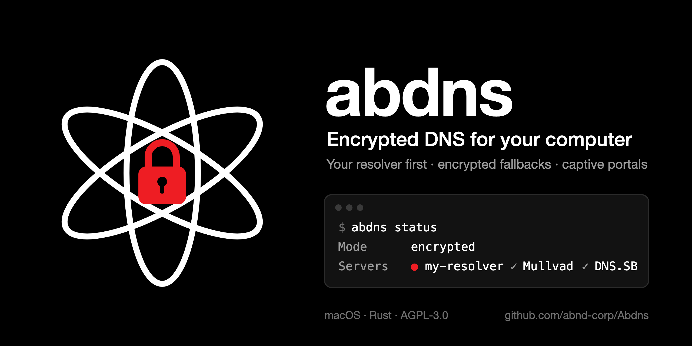

# abdns — encrypted DNS for your computer, with captive portal support

<p align="center"></p>

[](https://github.com/abnd-corp/Abdns/actions/workflows/ci.yml)

**English** · [Français](README.fr.md)

**abdns is a local DNS-over-HTTPS (DoH) client for macOS and Linux. It sends every DNS query to your own resolver first, then to encrypted fallbacks in the order you choose, and uses the network's DNS only as a last resort — for example to sign in to a captive portal on train, hotel or airport Wi-Fi. Every name sent in clear is reported to you.**

It is written in Rust: a small service (`abdnsd`) and a command-line tool (`abdns`), with its own DoH client (rustls, HTTP/2, the system's certificate store). Windows support is planned.

## Why

- **Your resolver, not someone else's.** Point your computer at a self-hosted DoH resolver (Unbound, Knot Resolver, AdGuard Home, Pi-hole behind a DoH front…), even by IP address only.
- **No censorship from public resolvers.** In several countries, large public resolvers now apply court-ordered blocking or leave: in France, Google, Cloudflare, Cisco OpenDNS and DNS4EU have been ordered to block sites, and Quad9 stops serving French users on 24 November 2026.
- **Encrypted fallbacks, in your order.** If your resolver is down, the next server in your list answers, then the next. Servers are reached by IP address, so no plaintext lookup is ever needed to find them.
- **Captive portals still work.** Native encrypted DNS settings break most captive portals. abdns detects the situation, uses the network DNS just long enough, opens the sign-in page, and switches back to encrypted DNS as soon as it answers.
- **Nothing in clear without you knowing.** While the network DNS is used, new names are reported in a notification and every name is written to a log.

## How it works

```
applications ──► abdns (127.0.0.1:53) ──DoH──► server 1 (your resolver)
                    │                    └─DoH──► server 2, server 3… in order, only if the previous one fails
                    ├── local names (.local, .lan, 192.168.x.x reverse…) ──► network DNS, silently
                    └── last resort: network DNS (DHCP), in clear, reported
```

| Situation | What abdns does |
|---|---|
| Server 1 answers | Every query goes to it over DoH; answers are cached for their lifetime |
| Server 1 fails | The next server answers at once; server 1 is set aside (30 s, up to 5 min) and checked every 30 s |
| A fallback has been in use for 1 min | One notification ("Fallback server in use"), one more when server 1 is back |
| No server answers but an answer is cached | The last known answer is served (up to one day, RFC 8767) |
| Every server fails twice in a row **and** the network DNS answers (captive portal, DoH blocked) | Switches to the network DNS, notifies you once, opens the sign-in page if a portal is detected |
| New network with a captive portal | The portal is looked for during the first check: one failure of every server is enough, the sign-in page opens at once |
| No network, or a different one | No check without a network; a different network gets fresh connections (the cache stays), a short drop of the same one keeps them; waking from sleep also gets fresh connections |
| Encrypted DNS answers again | Switches back and tells you how long it stayed in clear and how many names were sent |
| Name of the local network (`nas.lan`, `printer.local`, `router.home.arpa`, DHCP domain, reverse lookup of a private address such as 192.168.x.x) | Always sent to the network DNS, never reported, never counted |
| DNSSEC failure (SERVFAIL from your resolver) | Stays an error: never a reason to switch to clear |
| The configuration file changes | Reloaded within 5 s; an invalid file is ignored and reported, the previous one stays |
| abdns stops or crashes | The system DNS is set back to the network's, so the machine is never left without DNS |

### Captive portals, step by step

1. You join the Wi-Fi of a train or hotel. Before you sign in, the network blocks every server in your list.
2. After two failed checks (about 15 s), abdns switches to the network DNS and notifies you once.
3. It loads Apple's test page through the network: if the answer is not the expected one, a portal is there, and abdns opens its sign-in page in your browser.
4. Once you are signed in, your encrypted servers answer again: abdns switches back within 10 s and notifies you.

Set `local_fallback = false` to forbid this last resort: portals will then not open, but nothing is ever sent in clear.

### Notifications, kept to a minimum

| Event | Notifications |
|---|---|
| Switch to the network DNS | 1 |
| Names sent in clear | new names only, grouped, at most every 5 min |
| Still in clear | 1 every 30 min |
| Back to encrypted DNS | 1 |
| Captive portal | 1 per network |
| Fallback server in use / main server back | 1 each |
| Configuration reloaded or ignored | 1 |

On top of that, never more than 6 notifications in 10 minutes; the rest only goes to the log.

## Installation (macOS and Linux)

abdns is two programs, like OpenSSH's `sshd` and `ssh`: **`abdnsd`**, the service, the only part that runs as root; and **`abdns`**, the command-line tool, which drives it over a protected local socket (administrators can change the mode or reload without `sudo`).

### Homebrew (macOS)

Available with the first published version.

```sh
brew install abnd-corp/tap/abdns
nano "$(brew --prefix)/etc/abdns/config.toml"   # your servers, in order
sudo brew services start abdns
```

### Release archive (macOS)

Available with the first published version.

Every version publishes a universal macOS archive (Apple silicon and Intel) with its SHA-256 checksum on the [releases page](https://github.com/abnd-corp/Abdns/releases). Download it with `curl` (a browser download would be quarantined, as the binaries are not notarized), then:

```sh
tar -xzf abdns-*-macos-universal.tar.gz && cd abdns-*-macos-universal
sudo install -m 755 abdns abdnsd /usr/local/bin/
sudo mkdir -p /etc/abdns && sudo cp config.example.toml /etc/abdns/config.toml
sudo abdns install        # launchd service, starts now and at boot
```

### From source

```sh
make release
sudo make install         # binaries, manual pages, launchd service
```

### Linux

Linux needs systemd and systemd-resolved (`resolvectl`). NetworkManager (`nmcli`) is optional but recommended: abdns reads the network's DNS from its DHCP lease and gives it back when it stops.

```sh
make release
sudo mkdir -p /etc/abdns && sudo cp config.example.toml /etc/abdns/config.toml   # your servers, in order
sudo make install         # binaries, manual pages, abdnsd.service (systemd)
```

Notifications and the captive portal page need `notify-send` (libnotify) and `xdg-open` (xdg-utils) in a graphical session. The log is `abdns logs -f` (`journalctl -u abdnsd`).

### With nix-darwin (macOS)

```nix
# flake.nix
inputs.abdns = { url = "github:abnd-corp/Abdns"; inputs.nixpkgs.follows = "nixpkgs"; };
# modules
abdns.darwinModules.default
{
  services.abdns = {
    enable = true;
    # Written to /etc/abdns/config.toml only if it does not exist; edit that file afterwards.
    initialSettings = {
      network_services = [ "Wi-Fi" "USB 10/100/1000 LAN" ];
      server = [
        { name = "My resolver"; url = "https://203.0.113.5/dns-query"; }
        { name = "Mullvad"; url = "https://dns.mullvad.net/dns-query"; ip = "194.242.2.2"; }
      ];
    };
  };
}
```

`sudo abdns uninstall` stops and removes the service and restores the network DNS (Homebrew: `sudo brew services stop abdns`).

### A secret DoH path (optional)

If your resolver protects its DoH endpoint with a secret path (`https://203.0.113.5/dns-query/<token>`), keep the token out of the configuration: give the server a `url` ending with `/` and a `token_file`, then:

```sh
printf '%s' 'https://203.0.113.5/dns-query/<token>' | sudo abdns token
```

The token is stored root-only and never written to any log: errors are logged without the URL.

## Configuration

`/etc/abdns/config.toml`, read again whenever it changes. Only `[[server]]` is required.

```toml
language = "en"           # notifications in "en" or "fr"
local_fallback = true     # network DNS as a last resort (captive portals)

[[server]]                # tried first
name = "Google"
url = "https://8.8.8.8/dns-query"

[[server]]                # tried if the first one fails
name = "Cloudflare"
url = "https://1.1.1.1/dns-query"
```

| Key | Default | Meaning |
|---|---|---|
| `language` | `"en"` | Notifications in `en` or `fr` |
| `local_fallback` | `true` | Use the network DNS when no server answers (captive portals) |
| `listen` | `127.0.0.1:53`, `[::1]:53` | Where the system sends its queries (restart to change) |
| `server` | — | DoH servers, in order: `name`, `url`, `ip` (required if the URL uses a host name), `token_file` |
| `network_services` | `["Wi-Fi"]` | macOS network services pointed to abdns (ignored on Linux: every physical interface the computer goes out by) |
| `state_dir` | `/var/run/abdns` | Status and forced mode |
| `clear_log` | `/var/log/abdns/clear.log` | Names sent in clear |

Google and Cloudflare are only well-known examples. Privacy-respecting fallbacks with no logs and no filtering include [Mullvad DNS](https://mullvad.net/en/help/dns-over-https-and-dns-over-tls) (`https://dns.mullvad.net/dns-query`, `194.242.2.2`), [DNS.SB](https://dns.sb) (`https://doh.dns.sb/dns-query`, `185.222.222.222`) and [Digitale Gesellschaft](https://www.digitale-gesellschaft.ch/dns/) (`https://dns.digitale-gesellschaft.ch/dns-query`, `185.95.218.42`).

## Usage

```sh
abdns status                  # mode, servers (● answering), network, names sent in clear
abdns test                    # query every server now, with its response time
abdns check                   # validate the configuration file, like sshd -t
abdns mode local              # force the network DNS (stubborn captive portal)
abdns mode encrypted          # forbid the network DNS
abdns mode auto               # back to automatic
abdns reload                  # read the configuration again now
abdns logs -f                 # follow the service log
abdns --json status           # machine-readable output
```

Manual pages: `man abdns`, `man abdnsd`. Shell completion: `abdns completions zsh|bash|fish` (installed automatically by Homebrew and Nix). Names sent in clear are all in `/var/log/abdns/clear.log`.

Notifications are shown through `osascript`: allow **Script Editor** in System Settings › Notifications. On Linux they go through `notify-send`, in the graphical session of the logged-in user.

## FAQ

**How do I use my own DNS-over-HTTPS server on macOS with a fallback?**
macOS encrypted DNS profiles accept a single server with no fallback. abdns sets the system DNS to a local client that tries your server first and your fallbacks next, in the order you write them.

**Does encrypted DNS work behind a captive portal (SNCF Wi-Fi, hotel, airport)?**
Not with native settings: the portal blocks the encrypted server before you sign in. abdns notices that every encrypted server fails while the network DNS answers, uses the network DNS for the sign-in, opens the portal page, and returns to encrypted DNS right after.

**Which DNS resolvers are not censored in France?**
Your own resolver, or no-log resolvers outside French jurisdiction such as Mullvad, DNS.SB or Digitale Gesellschaft. Google, Cloudflare, Cisco and DNS4EU apply French blocking orders, and Quad9 leaves France on 24 November 2026.

**Are local names like `nas.lan` or reverse lookups of 192.168.x.x sent to the internet?**
No. Names of the local network always go to the network DNS, in every mode, and are never reported or counted.

**Can I change servers without restarting?**
Yes. Edit the configuration file: abdns reloads it within 5 seconds and confirms with a notification. A mistake in the file is reported and the previous configuration stays in use.

**Does abdns work with a VPN?**
Yes. A VPN such as Proton VPN or WireGuard sets its own DNS while connected; abdns is used again as soon as it disconnects.

**What happens if abdns crashes?**
The system DNS is set back to the network's, and launchd (macOS) or systemd (Linux) restarts abdns within 30 seconds.

**Do I need Nix?**
No. Homebrew, the release archive and `make install` work without it.

## Limitations

- macOS and Linux for now; Windows is planned (`src/platform/`).
- Linux: systemd-resolved is required. abdns takes over the physical interfaces (Ethernet, Wi-Fi) the computer goes out by, not VPNs, bridges or containers, which keep their own DNS. If something else changes that setting, abdns sets it again within 5 seconds. If abdns is killed without warning (SIGKILL), the system keeps pointing to it until systemd restarts it, within 30 seconds.
- In local mode, answers are not DNSSEC-validated, and a network that deliberately blocks encrypted DNS gets local mode. Notifications make it visible; `local_fallback = false` or `abdns mode encrypted` forbids it.
- The network DNS is the one of the DHCP lease (IPv4).
- Browsers or apps with their own secure DNS setting, and iCloud Private Relay, bypass the system DNS. Set Firefox and Chrome secure DNS to "system".

## Compared with

| | abdns | macOS DNS profile | dnscrypt-proxy | AdGuard dnsproxy |
|---|---|---|---|---|
| Your own resolver first, strict order | yes | single server | no (fastest wins) | no (two tiers, load-balanced) |
| Encrypted fallbacks | yes | no | yes | yes |
| Captive portals | yes, automatic | no | no | no |
| Names sent in clear reported | yes | — | no | no |
| Local names kept local | yes | no | with rules | with rules |
| Configuration reloaded live | yes | — | no | no |

## Development

```sh
make check                      # formatting, Clippy (warnings as errors), tests: what CI runs
make build
```

To try abdns without touching the system DNS, use a `listen` port above 1024 and run `cargo run --bin abdnsd -- --config my.toml --no-system`, then query it with `dig @127.0.0.1 -p <port> example.com`. Only `src/platform/` depends on the operating system: Windows support means implementing its functions there. Dependencies and their changelogs: [`docs/stack.md`](docs/stack.md); design decisions: [`docs/adr/`](docs/adr/).

## Contributing

See [CONTRIBUTING.md](CONTRIBUTING.md). Security issues: [SECURITY.md](SECURITY.md).

## License

abdns is free software under the [GNU Affero General Public License v3.0 only](LICENSE) (AGPL-3.0-only): you may use, study, modify and share it. If you distribute a modified version, or let other machines use a modified version over a network (for example as a DNS relay for an office), you must publish its source code under the same license.

The name "abdns" designates the official versions from this repository; a modified version must use another name.
